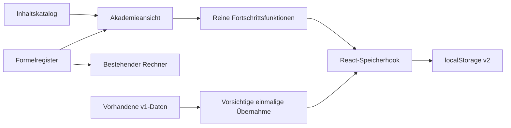

# Architektur · Version 0.2

## Ausgangspunkt und Entscheidungen

Ausgangspunkt: gemergte Version nach PR #3, `main` bei `3aa870e`. React, TypeScript, Vite, Tailwind, GitHub Pages, die alten drei Artikel, das Zwölf-Fragen-Quiz und der Wärmeleistungsrechner bleiben erhalten. Es gibt kein Backend, keinen API-Schlüssel und keinen verpflichtenden kostenpflichtigen Dienst.

Die aktuelle Priorität ist die Lernakademie. Sie hat einen eigenen Einstieg in der Hauptnavigation und auf dem Dashboard. Der bisherige Lernbereich bleibt als bestehendes Angebot erreichbar. Die neue Akademie verwendet keinen zweiten, unverbundenen Formelbestand: `sensible-heat` ist im zentralen Formelregister hinterlegt und wird auch vom vorhandenen Rechner zur Darstellung verwendet. Die getestete Rechenfunktion bleibt in `src/logic.ts`.

## Aufteilung

```text
src/
  App.tsx                         Navigation + alter Fortschritt + Akademie-Hook
  content.ts, content-types.ts    bestehende Artikel/Quizdaten
  logic.ts                        bestehende Berechnung und v1-Leser
  features/                      bestehendes Quiz und Rechner
  academy/
    model.ts                      zentrale Fach-/Inhalts-/Fortschrittstypen
    catalog.ts                    öffentlicher Katalogzugriff
    data/
      legacy.ts                   explizite Brücke zu bestehenden Artikeln
      domains.ts                  12 Fachgebiete mit Kapiteln/Unterkapiteln
      modules.ts                  5 Lernmodule × 3 Niveauvarianten
      registers.ts                Lernziele, Formeln, Quellen, Begriffe, Modellfall
      practice.ts                 20 Fragen mit stabilen Antwort-IDs, 10 Karten
    progress.ts                   Validierung, v1-Übernahme, Bewertung, Termine
    useAcademyProgress.ts         sicherer Speicher-Lebenszyklus
    Academy.tsx                   Suche/Filter, Struktur und gemeinsame Lernansicht
    components/
      ModuleQuiz.tsx              verständnisorientierte Fragen + Erklärungen
      ReviewCards.tsx             Karten und einfache Wiederholungsplanung
```

Die bestehenden Artikel sind Übergangsangebote, kein neu aufgebautes paralleles Fachsystem. `legacyBridges` verknüpft ihre IDs mit den Akademiemodulen und steuert sowohl die Migration als auch die direkte Vertiefungsnavigation. Neue Inhalte werden nur im gemeinsamen Akademiekatalog gepflegt.

Der Katalog ist statisch, typisiert und mit Git versioniert. Es wird nur so viel abstrahiert, wie derzeit mehrere Inhalte gemeinsam brauchen. Keine dynamische Skriptausführung, kein CMS, keine allgemeine Formel-Engine und keine neue Routingbibliothek.

## Datenfluss



Die reinen Funktionen erhalten den Zeitpunkt als optionales Argument. Dadurch lassen sich Wiederholungstermine deterministisch testen. React-Komponenten zeigen die Daten an und rufen die Funktionen auf. Der Hook hält den Zustand über Navigation hinweg und schreibt ihn unter einem versionierten Schlüssel.

## Gesamtsystem und Erweiterungspunkte

| Langfristiges Hauptmodul           | Anbindung                                                           | Stand 0.2                                                                |
| ---------------------------------- | ------------------------------------------------------------------- | ------------------------------------------------------------------------ |
| Lernakademie                       | Fachgebiete, Module, Lernziele, Fragen, Karten und Fortschritt      | Implementiert, begrenzter Beispielbestand                                |
| Fachbibliothek/Nachschlagewerk     | Gleiche Modul-/Begriffs-/Quellen-IDs; später andere Lesedarstellung | Alte Artikel und Begriffssuche vorhanden; keine separate neue Bibliothek |
| Technische Berechnungen            | Formel-ID ↔ `calculatorId` ↔ getestete Implementierung              | Sensible Wärmeleistung vorhanden                                         |
| Diagramme/Simulationen             | Später typisierte Inhaltsblöcke mit Bezug zu Modul/Formel           | Geplant; keine neue Simulation                                           |
| Bauteil-/Kältemitteldatenbank      | Später eigene geprüfte Entitäten mit Quellen und Zustandsbezug      | Geplant; keine erfundenen Stofftabellen                                  |
| Fehlersuche/Wartung/Inbetriebnahme | Reservierte `related`-Verweise zu Messung und Diagnose              | Beziehungen sichtbar als geplant, kein Diagnosewerkzeug                  |
| Planung/Projektdokumentation       | Spätere Projektfälle referenzieren dieselben fachlichen IDs         | Geplant; keine Projektverwaltung                                         |
| Quellen-/Normen-/Formelverwaltung  | Zentrale Register und Prüfstatus                                    | Register vorhanden, unabhängige Fachprüfung und Normenpflege noch offen  |

Beispiel: `superheat-subcooling` → Formel `superheat` → geplante Messung `superheat-measurement` → geplante Diagnose `superheat-diagnosis`. Diese geplanten Ziele sind nicht als funktionierende Werkzeuge verlinkt. Der vorhandene sensible Rechner wird über `sensible-heat-calculator` tatsächlich geöffnet.

## Veröffentlichung und Qualität

Vite-Basispfad bleibt `/kaeltemeister-pro/`. App und Produktionsassets werden im Browser geprüft. Die vorhandenen Actions mit Push auf `main`, `workflow_dispatch`, offiziellen Pages-Actions und Deployment-Berechtigungen bleiben bestehen. Neue Playwright-Tests werden durch die vorhandenen Workflows automatisch mit ausgeführt. Ein PR veröffentlicht keine Website; erst der Merge nach `main` startet das Deployment.

Die Architektur ermöglicht später eine optionale Synchronisation durch stabile IDs, Revisionen und UTC-Zeitpunkte. Sie implementiert sie noch nicht. Konfliktauflösung, Identität, Backend und Datenschutz müssen davor eigenständig spezifiziert und geprüft werden.
