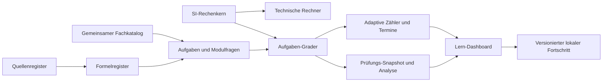

# Architektur · Version 0.3

## Ausgangslage

0.2 wurde vor Beginn in `main` bestätigt (PR #4, `f74d6f6`, erfolgreicher Pages-Lauf). React/TypeScript/Vite/Tailwind, bestehende Features und GitHub Pages bleiben erhalten. Keine neuen Abhängigkeiten, Server, API-Schlüssel oder verpflichtenden Abonnements.

## Gemeinsame Schichten

```text
src/technical/calculations.ts
  SI-Einheiten und reine Rechenfunktionen
  ↑ vorhandener Wärmeleistungsrechner und Aufgaben-Engine
src/academy/exercises/
  model.ts       Aufgaben-/Antwort-/Ergebnisverträge
  data.ts        8 Zahlenaufgaben + 2 begrenzte Fachnotizen
  items.ts       normalisierte Sicht auf vorhandene Modulfragen + 2 Elektrofragen
  engine.ts      Snapshot und zentrale Bewertung mit Toleranz
  TaskViews.tsx  gemeinsame Eingabe, Aufgabe, Lösung und Fachbezug
  Exercises.tsx  Training
src/academy/adaptive/
  algorithm.ts   transparente Zähler, Termine, Themenempfehlungen und Aktivitäten
  LearningDashboard.tsx
src/academy/exams/
  engine.ts      Auswahl, Deadline, Antwortannahme, idempotente Abgabe
  validation.ts  persistierte Prüfungen und Ergebnisse prüfen
  ExamMode.tsx   Konfiguration, Countdown, Durchführung und Analyse
src/academy/progress.ts
  v1/v2/v3-Leser, Migration, bestehende Lernaktionen
src/academy/useAcademyProgress.ts
  Speicherung, Fehlerhinweise und Deadline-Prüfung auch außerhalb der Prüfungsansicht
```

Die vorhandenen 20 Modulfragen werden für Prüfungen adaptiert, nicht unabhängig kopiert. Formeln und Quellen bleiben im gemeinsamen Register. Die technische Engine berechnet in SI; Anzeige-/Antwort-Einheiten sind Adapter. Der alte Wärmeleistungsrechner erhält seine bisherigen Eingaben/Ausgaben und ruft denselben Wärmekern auf.

Der Prüfungsmodus nutzt dieselben Eingabe-/Lösungsbausteine und denselben Grader wie das Training. Lösungen bleiben vor Abgabe verborgen. Ein Snapshot trennt eine laufende Prüfung von späterem Katalogwechsel. `finishExam` leert die aktive Sitzung und fügt deren ID genau einmal hinzu; wiederholte Deadline-Prüfungen zählen keine weiteren Versuche.

## Beziehungen und Zukunft



Ein zukünftiger Rechner kann denselben Berechnungstyp verwenden. log(p)-h-Diagramme benötigen zusätzlich verifizierte Zustands-/Stoffdaten und passende Kältemittelmodelle; sie werden nicht mit der sensiblen Wärmeformel simuliert. Bauteile, Diagnosefälle, Anlagenplanung und Projektdokumentation sollen stabile Fach-, Formel- und Quellen-IDs referenzieren. Keine unabhängigen zweiten Wissens- oder Formelbestände aufbauen.

## Grenzen

Kein CMS, Backend, allgemeiner Formelparser oder dynamisches Ausführen von Formeltexten. Keine realen Kältemittel-Stoffdaten. V3 speichert aggregierte Lernzähler, letzte Antworten, Aktivitäten und bis zu 20 Prüfungs-Snapshots; noch keine vollständige Ereignishistorie jedes Trainingsversuchs. Optionale Synchronisation braucht später Ereignis-/Reset-IDs, Konfliktregeln und Datenschutzentscheidungen.

## Veröffentlichung

Basispfad bleibt `/kaeltemeister-pro/`. Bestehende CI-/Pages-Workflows laufen auf PRs bzw. Push auf `main` und `workflow_dispatch`, mit bisherigen Berechtigungen und offiziellen Actions. Neue Tests werden über die bestehenden Befehle mit ausgeführt. Ein PR-Merge wird nicht automatisch vorgenommen. Erst danach ist der neue Produktions-Deploy überprüfbar.
